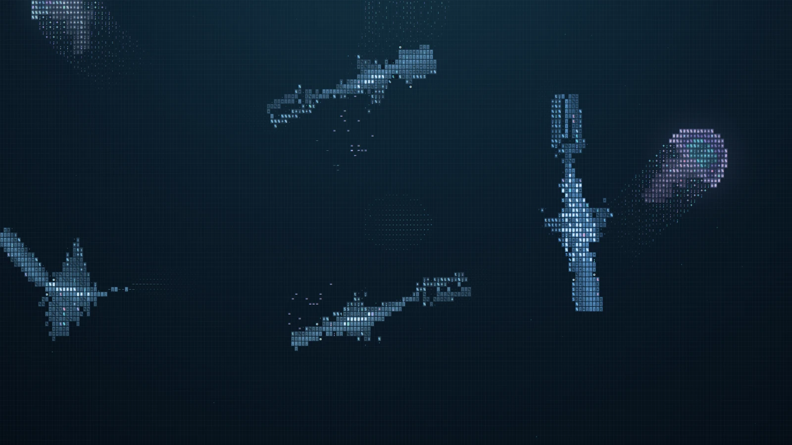

# Deep Sea Glyphs

A deep sea drawn in characters, swimming behind your Obsidian notes. Typing sends ripples through the water under the caret.

[中文说明](README.zh-CN.md) · [Releases](https://github.com/darkenness/deep-sea-glyphs/releases) · [Report an issue](https://github.com/darkenness/deep-sea-glyphs/issues)



## What it does

- **A living background.** Jellyfish pulse upward, hammerheads, manta rays and whale sharks cruise past, and small fish move in schools that scatter when something comes close.
- **Ripples as you type.** Each keystroke sends a ring of light out from the caret; a new line sends a bigger one. Pasting and unfinished IME input (pinyin, kana) don't trigger it.
- **A card to write on.** Your note sits on a translucent card so the text stays readable. Drag the card's left or right edge to make it wider or narrower; double-click an edge for full width.
- **Three moods.** Pastel, Blizzard and Calm change the colours of the water and every creature.
- **Optional glowing caret.** Install [Cursor-Smith](https://github.com/Sadsnake1/cursor-smith) as well and each mood also switches a matching caret, trail and key-sound preset.

## Glyph styles

The same scene in each style:

| ASCII | Braille |
|---|---|
|  |  |
| **Blocks** | **Chinese characters** |
|  |  |

## Install

Desktop only. Requires Obsidian 1.8.7 or later. Not yet in the community plugin list.

1. Download `main.js`, `manifest.json` and `styles.css` from the [latest release](https://github.com/darkenness/deep-sea-glyphs/releases/latest).
2. Put them in `<your vault>/.obsidian/plugins/deep-sea-glyphs/`.
3. Reload Obsidian and turn on **Deep Sea Glyphs** under **Settings → Community plugins**.

With [BRAT](https://github.com/TfTHacker/obsidian42-brat), add `darkenness/deep-sea-glyphs` instead.

The background starts as soon as the plugin is on, and Obsidian switches to its dark base theme. Your previous theme comes back when you turn the background off.

## Pairs with Cursor-Smith

Deep Sea Glyphs draws the water; [Cursor-Smith](https://github.com/Sadsnake1/cursor-smith) by Sadsnake1 draws the caret. Together the caret glows in the colours of the current mood.

1. Install and enable **Cursor-Smith** from the community plugins.
2. In **Settings → Deep Sea Glyphs → Cursor-Smith**, click **Add presets**. This adds *Deep Sea · Pastel*, *Deep Sea · Blizzard* and *Deep Sea · Calm* to Cursor-Smith's presets.
3. Change the mood and the caret follows.

Without Cursor-Smith everything else works the same.

## Using it

- **Status bar 🪼**: click to switch mood, right-click to turn the background on or off.
- **Card edge**: drag to resize, double-click for full width.
- **Command palette**: *Toggle background*, *Switch to next mood*, *Toggle full-width writing card*, *Pause or resume animation*. Each can take a hotkey.

Where to start in settings: if the background feels busy, raise **Background dimming** or lower the number of **Large swimmers**. On battery, lower the **Frame rate cap** (45 fps by default). **Glyph grid** changes the look the most: *Ultra fine* shows the smoothest outlines and costs the most per frame.

## Good to know

- **Power.** Drawing stops whenever Obsidian is in the background or minimised, and when the window loses focus (you can turn that last part off).
- **Themes.** While it is on, the plugin makes the workspace translucent by overriding Obsidian's standard colour variables and the backgrounds of core panes. Themes that paint their own opaque panels may need a CSS snippet. Turning the background off undoes every change. It has not yet been tested systematically across community themes; reports are welcome.
- **Dark mode switching** uses an internal Obsidian function (`changeTheme`). If a future Obsidian removes it, the plugin stops switching and nothing else breaks. Turn it off under *Switch to dark mode with the background* if you prefer to switch yourself.
- **Limitations.** No mobile support. Pop-out windows show no background. The plugin does not yet pause for the system's *reduce motion* setting; use **Pause or resume animation** or turn the background off.

## Privacy

- No network requests, no telemetry.
- It does not read or change your notes. While you type, it looks at each edit only to tell typing from pasting and to spot new lines, and reads the caret's position on screen. Nothing is stored.
- Settings are kept in the plugin's own `data.json`.
- It writes to Cursor-Smith only when you click **Add presets**, and asks Cursor-Smith to load a preset when you change mood (turn *Switch the Cursor-Smith preset with the mood* off to stop that).

## Development

```bash
npm install
npm run dev     # rebuild main.js on every change
npm run build   # type-check and production build
npm run lint    # Obsidian's review rules
```

`src/ocean/` holds the simulation and drawing, `src/editor/` caret tracking and card resizing, `src/settings.ts` the settings tab, `src/cursor-smith.ts` the optional link, and `src/i18n.ts` the English and Chinese text.

## Credits

- The way the ocean is drawn builds on [ascii-sharks](https://github.com/stackedlol/ascii-sharks) by drewdi (MIT).
- The look was inspired by [character-ocean](https://github.com/jiezi1234/character-ocean) by jiezi1234. No code from it is used.
- The glowing caret comes from [Cursor-Smith](https://github.com/Sadsnake1/cursor-smith) by Sadsnake1 when you install it. None of its code is included.

What came from where: [THIRD_PARTY_NOTICES.md](THIRD_PARTY_NOTICES.md).

## License

[MIT](LICENSE)
