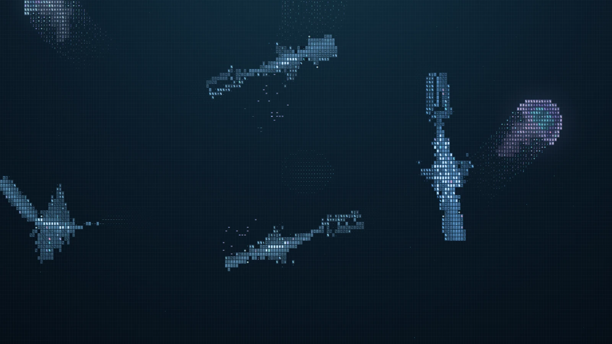

# Deep Sea Glyphs

一片用字符画成的深海，在你的 Obsidian 笔记背后游动。打字时，光标下方的水面会泛起水波。

[English](README.md) · [下载发布版](https://github.com/darkenness/deep-sea-glyphs/releases) · [反馈问题](https://github.com/darkenness/deep-sea-glyphs/issues)



## 能做什么

- **会动的背景**：水母一张一缩地向上游，双髻鲨、蝠鲼和鲸鲨从旁边游过，小鱼成群结队，有东西靠近时会四散开。
- **打字激起水波**：每敲一个字，光标处荡开一圈光；换行时水波更大。粘贴和还没上屏的输入法拼音不会触发。
- **写作卡片**：笔记放在一张半透明卡片上，文字始终清楚。拖动卡片左右边框可以调宽调窄，双击边框切换全宽。
- **三种氛围**：柔光、暴雪、静谧，水体和所有生物的配色一起变。
- **可选的发光光标**：再装上 [Cursor-Smith](https://github.com/Sadsnake1/cursor-smith)，每种氛围还会切换配套的光标、拖尾和键音预设。

## 字符风格

同一个场景，四种画法：

| ASCII | 盲文点阵 |
|---|---|
|  |  |
| **方块** | **汉字** |
|  |  |

## 安装

仅支持桌面端，需要 Obsidian 1.8.7 或更高版本。目前还没上架社区插件市场。

1. 从[最新发布版](https://github.com/darkenness/deep-sea-glyphs/releases/latest)下载 `main.js`、`manifest.json` 和 `styles.css`。
2. 放进 `<你的库>/.obsidian/plugins/deep-sea-glyphs/`。
3. 重启 Obsidian，在 **设置 → 第三方插件** 里启用 **Deep Sea Glyphs**。

也可以用 [BRAT](https://github.com/TfTHacker/obsidian42-brat)，添加 `darkenness/deep-sea-glyphs`。

启用后背景立即出现，Obsidian 会切到深色基础主题；关闭背景时恢复你原来的主题。

## 搭配 Cursor-Smith

Deep Sea Glyphs 画水，Sadsnake1 的 [Cursor-Smith](https://github.com/Sadsnake1/cursor-smith) 画光标。两个一起用，光标会带上当前氛围的颜色。

1. 从社区插件安装并启用 **Cursor-Smith**。
2. 在 **设置 → Deep Sea Glyphs → Cursor-Smith** 里点 **加入预设**，Cursor-Smith 的预设里会多出 *Deep Sea · Pastel*、*Deep Sea · Blizzard*、*Deep Sea · Calm* 三套。
3. 之后切换氛围，光标会跟着变。

不装 Cursor-Smith，其他功能照常使用。

## 怎么用

- **状态栏 🪼**：左键切换氛围，右键开关背景。
- **卡片边框**：拖动调宽度，双击切换全宽。
- **命令面板**：*开关深海背景*、*切换到下一种氛围*、*切换写作卡片全宽*、*暂停或恢复动画*，都可以绑快捷键。

设置从哪儿调起：觉得背景太热闹，就调高 **背景压暗**，或减少 **大型生物** 的数量；用电池时，调低 **帧率上限**（默认 45）。**字符网格** 对观感影响最大，*超精细* 轮廓最顺滑，每帧耗时也最多。

## 须知

- **耗电**：Obsidian 在后台或最小化时停止绘制；窗口失焦时也会停（可以在设置里关掉这一项）。
- **主题**：开启时，插件通过覆盖 Obsidian 的标准颜色变量和核心面板背景，让工作区变透明。自己绘制不透明面板的主题，可能需要额外的 CSS 片段。关闭背景会撤销所有改动。目前还没在各个社区主题下系统测试过，欢迎反馈。
- **深色模式切换**：用的是 Obsidian 的内部函数 `changeTheme`。如果以后的 Obsidian 去掉它，插件只是不再切换，其他功能不受影响。想自己切换的话，关掉 *随背景切换深色模式*。
- **限制**：不支持移动端；弹出窗口里没有背景；暂不响应系统的“减少动态效果”设置，需要时可用 **暂停或恢复动画**，或直接关闭背景。

## 隐私

- 不联网，不收集任何数据。
- 不读取、不修改你的笔记。打字时只查看每次编辑，用来区分打字和粘贴、识别换行，并读取光标在屏幕上的位置，不保存任何内容。
- 设置保存在插件自己的 `data.json` 里。
- 只有点 **加入预设** 时才会写入 Cursor-Smith 的设置；切换氛围时会让 Cursor-Smith 加载对应预设（关掉 *随氛围切换 Cursor-Smith 预设* 即可停止）。

## 开发

```bash
npm install
npm run dev     # 每次改动后重新构建 main.js
npm run build   # 类型检查并生成正式构建
npm run lint    # Obsidian 审核规则
```

`src/ocean/` 是模拟与绘制，`src/editor/` 是光标跟踪和卡片拖宽，`src/settings.ts` 是设置页，`src/cursor-smith.ts` 是可选联动，`src/i18n.ts` 是中英文文案。

## 致谢

- 海洋的绘制方式以 drewdi 的 [ascii-sharks](https://github.com/stackedlol/ascii-sharks)（MIT）为基础。
- 外观受 jiezi1234 的 [character-ocean](https://github.com/jiezi1234/character-ocean) 启发，没有使用它的代码。
- 发光光标来自 Sadsnake1 的 [Cursor-Smith](https://github.com/Sadsnake1/cursor-smith)，需要你自行安装，本插件不包含它的代码。

各部分的来源见 [THIRD_PARTY_NOTICES.md](THIRD_PARTY_NOTICES.md)。

## 许可证

[MIT](LICENSE)
